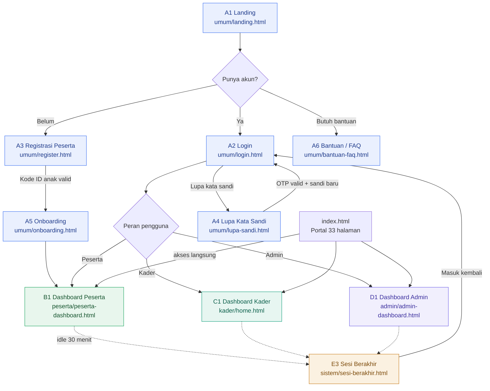
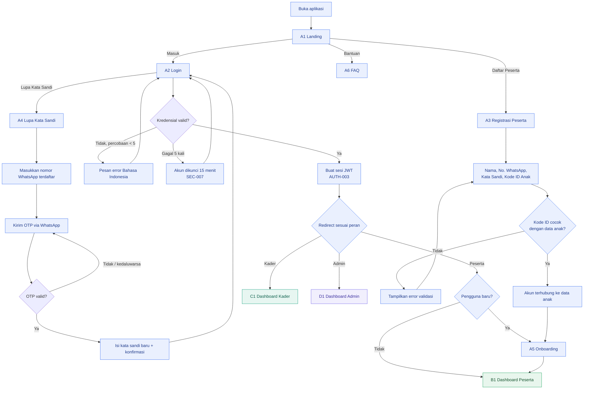
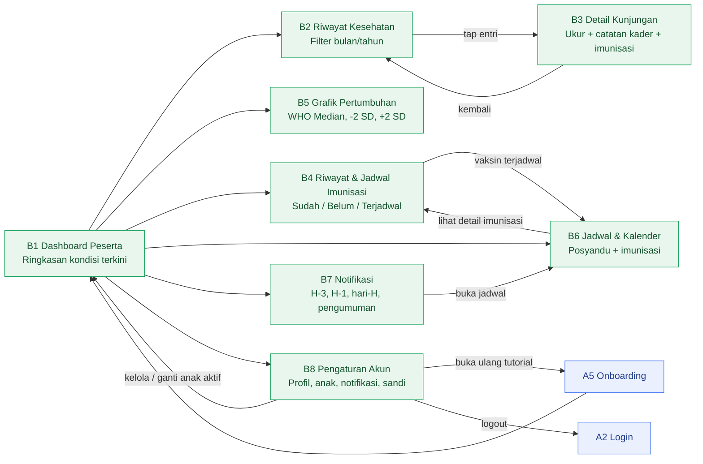
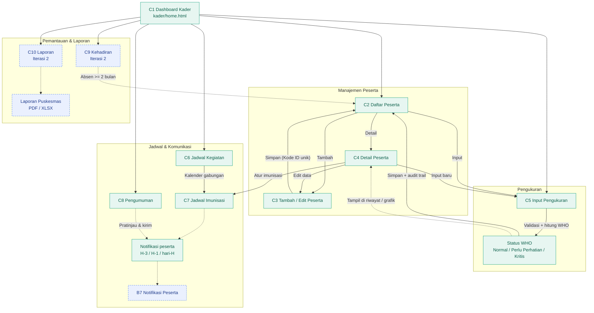
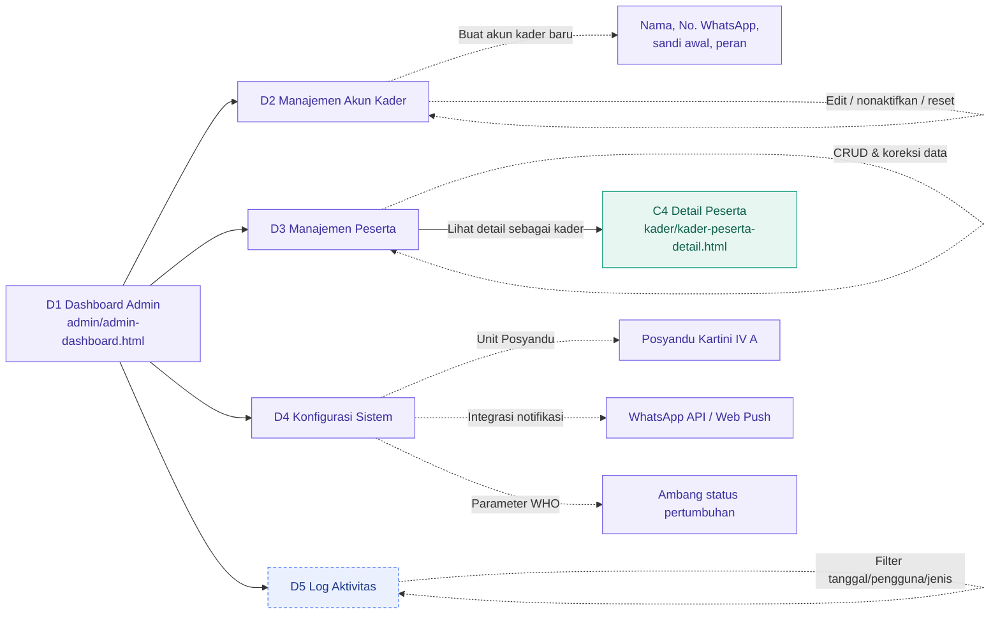
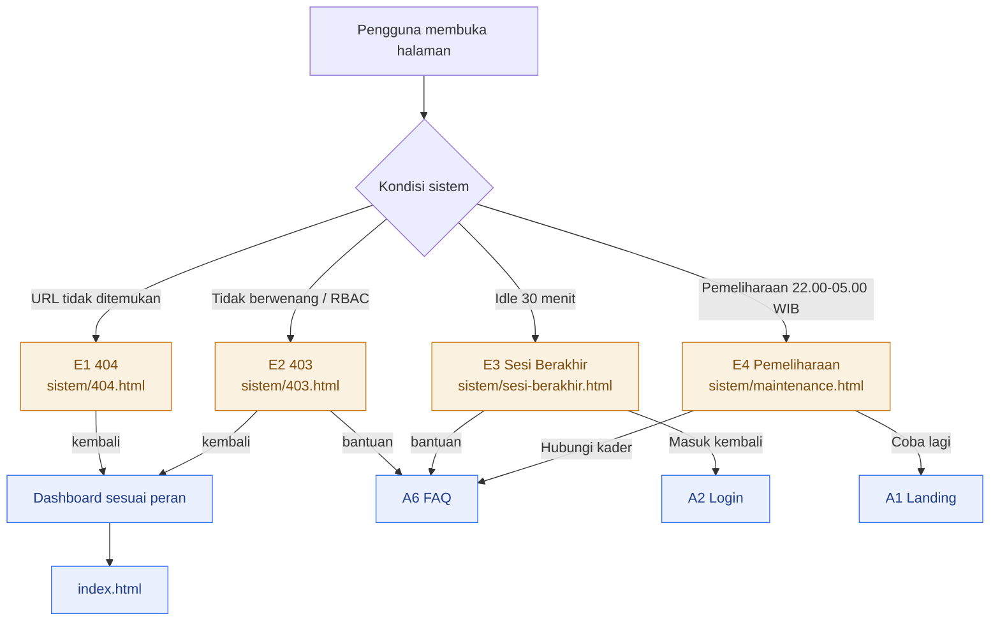
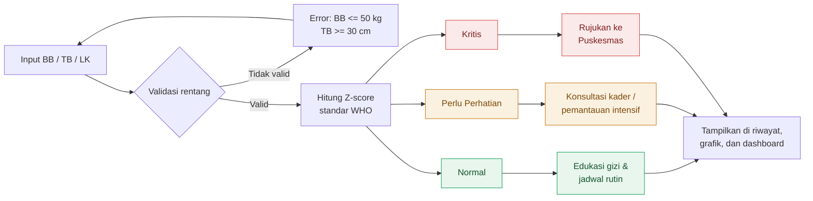
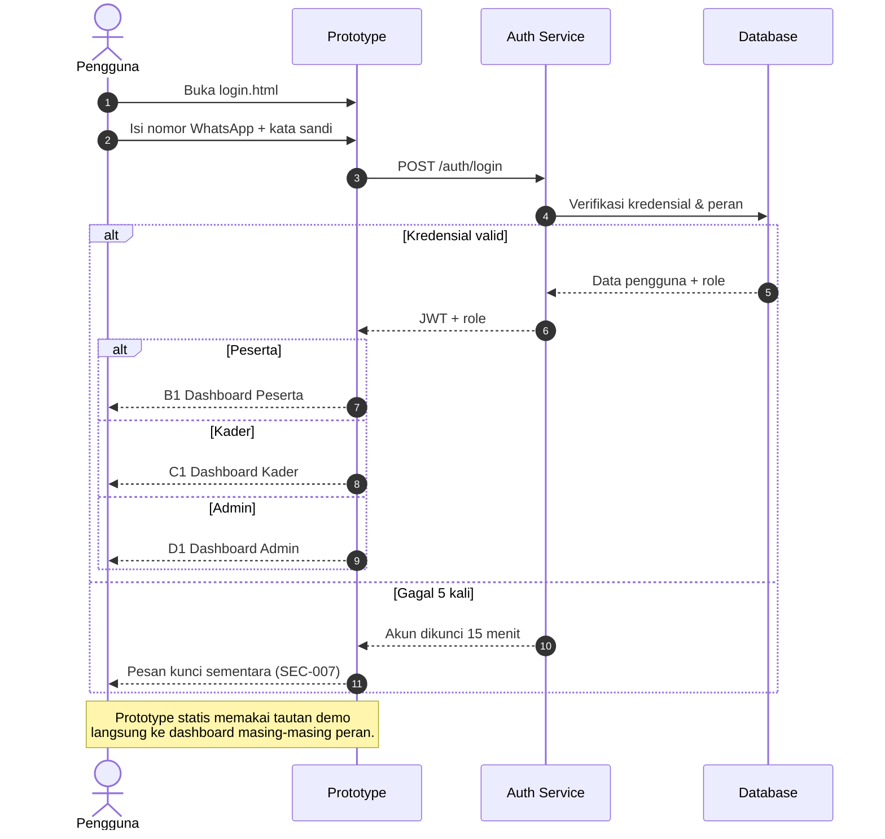
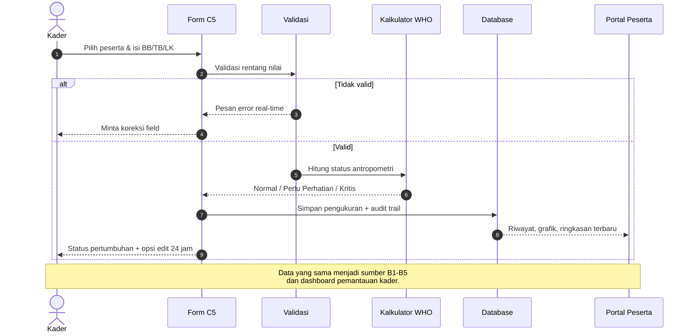
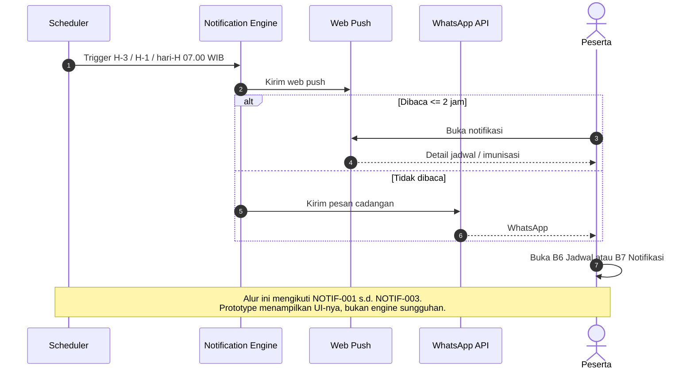

# Prototype Flow — SiPosya

**Sistem Informasi Posyandu Digital — Posyandu Kartini IV A**
Kelompok 12 TI-C1 · D4 Teknik Informatika · Universitas Airlangga

> Dokumen ini memetakan alur prototype berdasarkan **SRS SiPosya v1.0 (Oktober 2026)**, **list-all-page.txt (33 halaman)**, dan **seluruh file HTML yang sudah dibuat**. Struktur file telah dipisahkan per peran agar alur navigasi tidak tercampur.

---

## 1. Ringkasan Peran & Struktur Folder

| Kelompok | Folder | Peran | Jumlah Halaman | Fase |
|---|---|---|---|---:|---|
| Umum / Publik & Autentikasi | `umum/` | Semua | 6 | 🟢 MVP |
| Area Peserta | `peserta/` | Peserta (orang tua/wali) | 8 | 🟢 MVP |
| Area Kader | `kader/` | Kader Posyandu | 10 + 1 duplikat | 🟢 MVP + 🔵 Iterasi 2 |
| Area Administrator | `admin/` | Administrator | 5 | 🟢 MVP + 🔵 Iterasi 2 |
| Halaman Sistem | `sistem/` | Semua | 4 | 🟢 MVP |
| **Total** | — | — | **33 halaman** | — |

**Struktur file aktual:**

```text
allpage/
├─ index.html                         # Portal seluruh halaman
├─ PROTOTYPE-FLOW.md                  # Dokumen ini
├─ SRS.md
├─ list-all-page.txt
├─ umum/
│  ├─ landing.html                    # A1
│  ├─ login.html                      # A2
│  ├─ register.html                   # A3
│  ├─ lupa-sandi.html                 # A4
│  ├─ onboarding.html                 # A5
│  └─ bantuan-faq.html                # A6
├─ peserta/
│  ├─ peserta-dashboard.html          # B1
│  ├─ peserta-riwayat.html            # B2
│  ├─ peserta-kunjungan-detail.html   # B3
│  ├─ peserta-imunisasi.html          # B4
│  ├─ peserta-grafik.html             # B5
│  ├─ peserta-jadwal.html             # B6
│  ├─ peserta-notifikasi.html         # B7
│  └─ peserta-pengaturan.html         # B8
├─ kader/
│  ├─ home.html                       # C1 (dashboard utama)
│  ├─ kader-dashboard.html            # C1 (duplikat desain)
│  ├─ kader-peserta.html              # C2
│  ├─ kader-peserta-form.html         # C3
│  ├─ kader-peserta-detail.html       # C4
│  ├─ kader-input-pengukuran.html     # C5
│  ├─ kader-jadwal.html               # C6
│  ├─ kader-imunisasi.html            # C7
│  ├─ kader-pengumuman.html           # C8
│  ├─ kader-kehadiran.html            # C9
│  └─ kader-laporan.html              # C10
├─ admin/
│  ├─ admin-dashboard.html            # D1
│  ├─ admin-kader.html                # D2
│  ├─ admin-peserta.html              # D3
│  ├─ admin-konfigurasi.html          # D4
│  └─ admin-log.html                  # D5
└─ sistem/
   ├─ 404.html                        # E1
   ├─ 403.html                        # E2
   ├─ sesi-berakhir.html              # E3
   └─ maintenance.html                # E4
```

> **Catatan:** `kader/home.html` adalah dashboard kader yang menjadi acuan desain. `kader/kader-dashboard.html` adalah duplikat desain dengan navigasi sidebar yang lebih lengkap. Keduanya dipertahankan.

---

## 2. Peta Halaman & Traceability SRS

| Kode | Halaman | File | Peran | Fase | Referensi SRS |
|---|---|---|---|---|---|
| A1 | Landing Page | `umum/landing.html` | Semua | 🟢 | Batasan 2.4 |
| A2 | Login | `umum/login.html` | Semua | 🟢 | AUTH-002, AUTH-003, SEC-002, SEC-007 |
| A3 | Registrasi Peserta | `umum/register.html` | Peserta | 🟢 | AUTH-001, KADER-002 |
| A4 | Lupa Kata Sandi | `umum/lupa-sandi.html` | Semua | 🟢 | AUTH-004 |
| A5 | Onboarding | `umum/onboarding.html` | Semua | 🟢 | SRS 5.1 |
| A6 | Bantuan / FAQ | `umum/bantuan-faq.html` | Semua | 🟢 | — |
| B1 | Dashboard Peserta | `peserta/peserta-dashboard.html` | Peserta | 🟢 | RIWAYAT-005, RIWAYAT-007, GRAFIK-005 |
| B2 | Riwayat Kesehatan Anak | `peserta/peserta-riwayat.html` | Peserta | 🟢 | RIWAYAT-001, RIWAYAT-003, RIWAYAT-006, RIWAYAT-007 |
| B3 | Detail Kunjungan | `peserta/peserta-kunjungan-detail.html` | Peserta | 🟢 | RIWAYAT-001, RIWAYAT-002, RIWAYAT-004, RIWAYAT-007 |
| B4 | Riwayat & Jadwal Imunisasi | `peserta/peserta-imunisasi.html` | Peserta | 🟢 | RIWAYAT-002, NOTIF-003 |
| B5 | Grafik Pertumbuhan | `peserta/peserta-grafik.html` | Peserta | 🟢 | GRAFIK-001 s.d. GRAFIK-006 |
| B6 | Jadwal & Kalender Kegiatan | `peserta/peserta-jadwal.html` | Peserta | 🟢 | KADER-016, NOTIF-001, NOTIF-003 |
| B7 | Notifikasi & Pengumuman | `peserta/peserta-notifikasi.html` | Peserta | 🟢 | NOTIF-001 s.d. NOTIF-005, NOTIF-007 |
| B8 | Pengaturan Akun Peserta | `peserta/peserta-pengaturan.html` | Peserta | 🟢 | NOTIF-004, RIWAYAT-008, AUTH-005 |
| C1 | Dashboard Kader | `kader/home.html` | Kader | 🟢 | KADER-005, KADER-016, GRAFIK-007 |
| C2 | Daftar Peserta | `kader/kader-peserta.html` | Kader | 🟢 | KADER-003, KADER-005, KADER-006 |
| C3 | Tambah / Edit Peserta | `kader/kader-peserta-form.html` | Kader | 🟢 | KADER-001, KADER-002, KADER-004 |
| C4 | Detail Peserta (Kader) | `kader/kader-peserta-detail.html` | Kader | 🟢 | KADER-004, RIWAYAT-001, GRAFIK-007 |
| C5 | Input Hasil Pengukuran | `kader/kader-input-pengukuran.html` | Kader | 🟢 | KADER-007 s.d. KADER-013 |
| C6 | Kelola Jadwal Kegiatan | `kader/kader-jadwal.html` | Kader | 🟢 | KADER-014, KADER-016 |
| C7 | Kelola Jadwal Imunisasi | `kader/kader-imunisasi.html` | Kader | 🟢 | KADER-015 |
| C8 | Kirim Pengumuman | `kader/kader-pengumuman.html` | Kader | 🟢 | NOTIF-005, NOTIF-007 |
| C9 | Pemantauan Kehadiran | `kader/kader-kehadiran.html` | Kader | 🔵 | HADIR-001 s.d. HADIR-004 |
| C10 | Rekap & Laporan Bulanan | `kader/kader-laporan.html` | Kader | 🔵 | LAPORAN-001 s.d. LAPORAN-004 |
| D1 | Dashboard Administrator | `admin/admin-dashboard.html` | Admin | 🟢 | SRS 8.2 |
| D2 | Manajemen Akun Kader | `admin/admin-kader.html` | Admin | 🟢 | AUTH-006 |
| D3 | Manajemen Peserta (Admin) | `admin/admin-peserta.html` | Admin | 🟢 | SRS 8.2 |
| D4 | Konfigurasi Sistem | `admin/admin-konfigurasi.html` | Admin | 🟢 | Batasan 2.4 |
| D5 | Log Aktivitas Sistem | `admin/admin-log.html` | Admin | 🔵 | AUTH-007, NOTIF-006 |
| E1 | Error 404 | `sistem/404.html` | Semua | 🟢 | — |
| E2 | Akses Ditolak (403) | `sistem/403.html` | Semua | 🟢 | SEC-004, SEC-005 |
| E3 | Sesi Berakhir | `sistem/sesi-berakhir.html` | Semua | 🟢 | AUTH-005 |
| E4 | Pemeliharaan Sistem | `sistem/maintenance.html` | Semua | 🟢 | AVAIL-002 |

**Legenda fase:** 🟢 MVP · 🔵 Iterasi 2
**Legenda diagram:** garis **solid** = alur yang dapat ditelusuri di prototype (tautan halaman atau aksi form/tombol); garis **putus-putus** = alur otomatis/backend atau tautan lintas peran yang belum berupa tombol langsung.

---

## 3. Alur Utama Berdasarkan Peran

### 3.1 Routing Awal & Pemilihan Peran



### 3.2 Autentikasi, Registrasi & Pemulihan Akun



> **Catatan prototype:** tab peran dan tombol demo pada `umum/login.html` mengarah ke dashboard masing-masing (`peserta-dashboard`, `kader/home`, `admin-dashboard`) agar alur dapat dicoba tanpa backend.

---

### 3.3 Alur Peserta (Orang Tua / Wali)



**Poin penting:**
- Semua halaman peserta hanya menampilkan data anak milik akun yang login (`SEC-004`, `SEC-005`).
- Pemilih anak aktif berada di B1/B8; tidak ada halaman terpisah.
- Grafik B5 memakai referensi WHO dan dapat digeser horizontal pada layar kecil.
- Notifikasi B7 menandai pesan sudah/belum dibaca.

---

### 3.4 Alur Kader (Input Data & Operasional)



**Alur input pengukuran (C5) secara rinci:**

1. Pilih/konfirmasi peserta dari daftar atau pencarian.
2. Isi tanggal kunjungan, BB, TB, lingkar kepala (opsional), dan status imunisasi.
3. Validasi otomatis berjalan; error ditampilkan di field terkait.
4. Sistem menghitung status pertumbuhan berdasarkan tabel WHO.
5. Data disimpan dengan audit trail (nama kader + waktu).
6. Kader melihat status akhir dan dapat mengedit dalam 24 jam.
7. Data langsung muncul di riwayat, grafik, dan dashboard peserta.

---

### 3.5 Alur Administrator



**Batasan admin (sesuai SRS 8.2):**
- Hanya admin yang dapat membuat/mengelola akun kader (`AUTH-006`).
- Admin dapat melakukan CRUD seluruh peserta sebagai cadangan/koreksi lintas kader.
- Konfigurasi sistem hanya tersedia untuk admin.

---

### 3.6 Alur Halaman Sistem / Utilitas



---

## 4. Sub-Alur Status Pertumbuhan (WHO)



Status ini bersifat **indikatif** dan bukan pengganti konsultasi medis (SRS 2.4). Acuan: WHO Child Growth Standards dan Permenkes No. 2 Tahun 2020.

---

## 5. Sequence Diagram Alur Kritis

### 5.1 Login & Redirect Berdasarkan Peran



### 5.2 Input Pengukuran hingga Tampil ke Peserta



### 5.3 Pengingat Jadwal Otomatis



---

## 6. Matriks Hak Akses Prototype

| Fitur / Modul | Admin | Kader | Peserta |
|---|:---:|:---:|:---:|
| Registrasi & Login | ✅ | ✅ (dibuat admin) | ✅ |
| Tambah/Edit Data Peserta | ✅ | ✅ | ❌ |
| Input Hasil Pengukuran | ✅ | ✅ | ❌ |
| Lihat Riwayat Anak | ✅ (semua) | ✅ (semua) | ✅ (anak sendiri) |
| Lihat Grafik Pertumbuhan | ✅ (semua) | ✅ (semua) | ✅ (anak sendiri) |
| Kelola Jadwal Kegiatan | ✅ | ✅ | ❌ |
| Terima Notifikasi Jadwal | ✅ | ❌ | ✅ |
| Kirim Pengumuman | ✅ | ✅ | ❌ |
| Pemantauan Kehadiran | ✅ | ✅ | ❌ |
| Unduh Laporan Bulanan | ✅ | ✅ | ❌ |
| Manajemen Akun Kader | ✅ | ❌ | ❌ |

Sumber: SRS 8.2. Pelanggaran akses diarahkan ke **E2 403** (`SEC-004`, `SEC-005`).

---

## 7. Cakupan Modul & Halaman

| Modul SRS | Halaman Terkait | Status |
|---|---|---|
| AUTH | A2, A3, A4, E3, D2 | 🟢 MVP |
| Dashboard Kader / Input Data (I-4) | C1–C8 | 🟢 MVP |
| Riwayat Kesehatan Anak (I-1) | B1–B4, C4 | 🟢 MVP |
| Grafik Pertumbuhan & Status (I-3) | B1, B5, C1, C4 | 🟢 MVP |
| Pengingat Jadwal Otomatis (I-2) | B6, B7, C6, C7, C8 | 🟢 MVP |
| Pemantauan Kehadiran (I-6) | C9 | 🔵 Iterasi 2 |
| Rekap & Laporan Bulanan (I-5) | C10 | 🔵 Iterasi 2 |
| Tata kelola & audit | D1–D5 | 🟢 MVP + 🔵 Iterasi 2 |
| Utilitas sistem | E1–E4 | 🟢 MVP |

---

## 8. Catatan Implementasi Prototype

1. **Statis, tanpa JavaScript.** Seluruh halaman dibuat dengan HTML + CSS inline. Interaksi visual (tab, toggle, stepper, checklist) adalah mockup; navigasi memakai tautan antarfolder yang sudah diperbaiki.
2. **Satu file per halaman.** Setiap halaman memuat CSS-nya sendiri dan mengikuti design system `kader/home.html`: warna aksen `#0f9d7a`, font Inter, kartu `radius 16px`, sidebar desktop, dan hamburger CSS-only di seluler.
3. **Struktur per peran.** Folder `umum`, `peserta`, `kader`, `admin`, dan `sistem` memisahkan konteks agar prototype mudah ditinjau.
4. **Portal indeks.** `index.html` di root menjadi pintu masuk ke seluruh 33 halaman dan tetap menampilkan kelompok A–E.
5. **Duplikat dashboard.** `kader/home.html` adalah acuan desain; `kader/kader-dashboard.html` adalah variasi dengan sidebar lengkap.
6. **Belum ada backend.** Login, OTP, penyimpanan, notifikasi, ekspor PDF/XLSX, dan pembatasan RBAC masih berupa tampilan/alur, bukan fungsi nyata.
7. **Aksesibilitas & responsif.** Layout diuji pada lebar 320–1440 px; tabel lebar dapat digeser horizontal, tab panjang dapat di-scroll, dan sidebar berubah menjadi menu hamburger pada layar kecil.

---

*Disusun berdasarkan SRS SiPosya v1.0 dan 33 halaman prototype — Kelompok 12 TI-C1, Universitas Airlangga, 2026.*
