# Prototype Flow — PosCare Mobile

**Aplikasi Mobile Sistem Informasi Posyandu Digital — Android & iOS**

> Dokumen ini memetakan alur prototype aplikasi mobile berdasarkan **SRS SiPosya v1.0**, **mobile-page.md (59 layar)**, dan **PROTOTYPE-FLOW.md versi web**. Aplikasi melayani dua peran: **Orang Tua (Peserta)** dan **Kader**. Fungsi Administrator tetap di dashboard web.

---

## 1. Ringkasan Peran & Struktur Prototype

| Kelompok | Halaman Figma | Peran | Jumlah Layar | Fase |
|---|---|---|---:|---|
| Umum & Autentikasi | `01 · Umum` | Semua | 12 | 🟢 MVP |
| Area Orang Tua | `02 · Orang Tua` | Peserta (orang tua/wali) | 18 | 🟢 MVP + 🟣 Usulan |
| Area Kader | `03 · Kader` | Kader Posyandu | 20 | 🟢 MVP + 🔵 Iterasi 2 + 🟣 Usulan |
| Layar Sistem & Komponen | `04 · Sistem` | Semua | 9 | 🟢 MVP + 🟣 Usulan |
| **Total** | — | — | **59 layar** | — |

**Struktur file prototype (Figma), frame 390 × 844 pt:**

```text
PosCare Mobile (Figma)
├─ 00 · Cover & Flow Map               # Ringkasan alur (dokumen ini)
├─ 01 · Umum
│  ├─ A1  Splash
│  ├─ A2  Onboarding (3 slide)
│  ├─ A3  Selamat Datang
│  ├─ A4  Login
│  ├─ A5  Registrasi 1 · Data Diri
│  ├─ A6  Registrasi 2 · Hubungkan Anak
│  ├─ A7  Registrasi 3 · Kata Sandi
│  ├─ A8  Verifikasi OTP WhatsApp
│  ├─ A9  Lupa Kata Sandi
│  ├─ A10 Izin Notifikasi
│  ├─ A11 Registrasi Berhasil
│  └─ A12 Syarat & Kebijakan Privasi
├─ 02 · Orang Tua
│  ├─ B1  Beranda                      # Tab 🏠
│  ├─ B2  Pilih Anak                   # overlay bottom sheet
│  ├─ B3  Hubungkan Anak Baru
│  ├─ B4  Riwayat Kesehatan            # Tab 📋
│  ├─ B5  Detail Kunjungan
│  ├─ B6  Imunisasi
│  ├─ B7  Grafik Pertumbuhan           # Tab 📈
│  ├─ B8  Detail Titik Grafik          # overlay bottom sheet
│  ├─ B9  Jadwal & Kalender            # Tab 📅
│  ├─ B10 Detail Jadwal
│  ├─ B11 Notifikasi
│  ├─ B12 Detail Pengumuman
│  ├─ B13 Akun Saya                    # Tab 👤
│  ├─ B14 Edit Profil
│  ├─ B15 Pengaturan Notifikasi
│  ├─ B16 Kartu Anak Digital           # 🟣
│  ├─ B17 Ubah Sandi & Keamanan
│  └─ B18 Anak Saya
├─ 03 · Kader
│  ├─ C1  Dashboard Kader              # Tab 🏠
│  ├─ C2  Daftar Peserta               # Tab 👥
│  ├─ C3  Detail Peserta
│  ├─ C4  Tambah / Edit Peserta
│  ├─ C5  Peserta Berhasil Didaftarkan
│  ├─ C6  Pindai QR Kartu Anak         # 🟣
│  ├─ C7  Input Pengukuran · Pilih     # Tombol ➕
│  ├─ C8  Input Pengukuran · Form
│  ├─ C9  Hasil Pengukuran
│  ├─ C10 Edit Pengukuran
│  ├─ C11 Kelola Jadwal                # Tab 📅
│  ├─ C12 Tambah / Ubah Jadwal
│  ├─ C13 Atur Jadwal Imunisasi
│  ├─ C14 Kirim Pengumuman
│  ├─ C15 Riwayat Pengumuman
│  ├─ C16 Pemantauan Kolektif
│  ├─ C17 Kehadiran                    # 🔵
│  ├─ C18 Laporan Bulanan              # 🔵
│  ├─ C19 Akun Kader                   # Tab 👤
│  └─ C20 Notifikasi Kader
├─ 04 · Sistem
│  ├─ D1  Tidak Ada Koneksi
│  ├─ D2  Sesi Berakhir
│  ├─ D3  Akses Ditolak
│  ├─ D4  Pemeliharaan
│  ├─ D5  Pembaruan Wajib              # 🟣
│  ├─ D6  Dialog Konfirmasi            # komponen / overlay
│  ├─ D7  Toast / Snackbar             # komponen / overlay
│  ├─ D8  Bantuan, FAQ & Tentang
│  └─ D9  Empty State & Skeleton       # komponen
└─ 05 · Komponen
   ├─ Tab Bar Orang Tua / Tab Bar Kader (variant aktif per tab)
   ├─ Header + Lonceng Notifikasi
   ├─ Bottom Sheet, Dialog, Toast
   └─ Status Pill, Kartu, Input, Stepper, Tombol
```

**Titik mulai prototype (Flow starting points di Figma):**

| Flow | Mulai dari | Alur yang bisa dicoba |
|---|---|---|
| 1. Pengguna Baru | A1 Splash | Onboarding → Registrasi 3 langkah → OTP → Izin Notifikasi → B1 |
| 2. Orang Tua | B1 Beranda | Riwayat, Grafik, Imunisasi, Jadwal, Notifikasi, Akun |
| 3. Kader — Input Pengukuran | C1 Dashboard | ➕ → C7 → C8 → C9 → peserta berikutnya |
| 4. Kader — Peserta Baru | C2 Daftar Peserta | C4 → C5 (Kode ID + QR) |
| 5. Kader — Jadwal & Pengumuman | C11 Kelola Jadwal | C12, C13, C14 → C15 |
| 6. Kondisi Sistem | D1 Tidak Ada Koneksi | D1–D9 |

> **Catatan:** frame berlabel overlay (B2, B8, D6, D7) tidak berdiri sendiri. Di prototype, frame ini dibuka dengan aksi *Open overlay* dari layar induknya.

---

## 2. Peta Layar & Traceability SRS

| Kode | Layar | Frame | Peran | Fase | Referensi SRS |
|---|---|---|---|---|---|
| A1 | Splash Screen | `01 · Umum / A1` | Semua | 🟢 | AUTH-005 |
| A2 | Onboarding | `01 · Umum / A2` | Semua | 🟢 | SRS 5.1 |
| A3 | Selamat Datang | `01 · Umum / A3` | Semua | 🟢 | AUTH-006 |
| A4 | Login | `01 · Umum / A4` | Semua | 🟢 | AUTH-002, AUTH-003, SEC-007 |
| A5 | Registrasi 1 · Data Diri | `01 · Umum / A5` | Orang Tua | 🟢 | AUTH-001 |
| A6 | Registrasi 2 · Hubungkan Anak | `01 · Umum / A6` | Orang Tua | 🟢 | AUTH-001, KADER-002 |
| A7 | Registrasi 3 · Kata Sandi | `01 · Umum / A7` | Orang Tua | 🟢 | AUTH-001, SEC-002 |
| A8 | Verifikasi OTP WhatsApp | `01 · Umum / A8` | Semua | 🟢 | AUTH-004 |
| A9 | Lupa Kata Sandi | `01 · Umum / A9` | Semua | 🟢 | AUTH-004 |
| A10 | Izin Notifikasi | `01 · Umum / A10` | Semua | 🟢 | NOTIF-001, NOTIF-004 |
| A11 | Registrasi Berhasil | `01 · Umum / A11` | Orang Tua | 🟢 | AUTH-001 |
| A12 | Syarat & Kebijakan Privasi | `01 · Umum / A12` | Semua | 🟢 | SEC-005 |
| B1 | Beranda | `02 · Orang Tua / B1` | Orang Tua | 🟢 | RIWAYAT-005, RIWAYAT-007, GRAFIK-005 |
| B2 | Pilih Anak (bottom sheet) | `02 · Orang Tua / B2` | Orang Tua | 🟢 | RIWAYAT-008 |
| B3 | Hubungkan Anak Baru | `02 · Orang Tua / B3` | Orang Tua | 🟢 | RIWAYAT-008, KADER-002 |
| B4 | Riwayat Kesehatan | `02 · Orang Tua / B4` | Orang Tua | 🟢 | RIWAYAT-001, RIWAYAT-003, RIWAYAT-006, RIWAYAT-007 |
| B5 | Detail Kunjungan | `02 · Orang Tua / B5` | Orang Tua | 🟢 | RIWAYAT-001, RIWAYAT-002, RIWAYAT-004, RIWAYAT-007 |
| B6 | Imunisasi | `02 · Orang Tua / B6` | Orang Tua | 🟢 | RIWAYAT-002, NOTIF-003 |
| B7 | Grafik Pertumbuhan | `02 · Orang Tua / B7` | Orang Tua | 🟢 | GRAFIK-001 s.d. GRAFIK-006 |
| B8 | Detail Titik Grafik (bottom sheet) | `02 · Orang Tua / B8` | Orang Tua | 🟢 | GRAFIK-003 |
| B9 | Jadwal & Kalender | `02 · Orang Tua / B9` | Orang Tua | 🟢 | KADER-016, NOTIF-001, NOTIF-003 |
| B10 | Detail Jadwal | `02 · Orang Tua / B10` | Orang Tua | 🟢 | KADER-016, NOTIF-003 |
| B11 | Notifikasi | `02 · Orang Tua / B11` | Orang Tua | 🟢 | NOTIF-001 s.d. NOTIF-005, NOTIF-007 |
| B12 | Detail Pengumuman | `02 · Orang Tua / B12` | Orang Tua | 🟢 | NOTIF-005 |
| B13 | Akun Saya | `02 · Orang Tua / B13` | Orang Tua | 🟢 | RIWAYAT-008, NOTIF-004 |
| B14 | Edit Profil | `02 · Orang Tua / B14` | Semua | 🟢 | AUTH-004 |
| B15 | Pengaturan Notifikasi | `02 · Orang Tua / B15` | Semua | 🟢 | NOTIF-004 |
| B16 | Kartu Anak Digital | `02 · Orang Tua / B16` | Orang Tua | 🟣 | — (usulan mobile) |
| B17 | Ubah Sandi & Keamanan | `02 · Orang Tua / B17` | Semua | 🟢 / 🟣 | SEC-002, AUTH-005, AUTH-007 |
| B18 | Anak Saya | `02 · Orang Tua / B18` | Orang Tua | 🟢 | RIWAYAT-008 |
| C1 | Dashboard Kader | `03 · Kader / C1` | Kader | 🟢 | KADER-005, KADER-016, GRAFIK-007 |
| C2 | Daftar Peserta | `03 · Kader / C2` | Kader | 🟢 | KADER-003, KADER-005, KADER-006 |
| C3 | Detail Peserta | `03 · Kader / C3` | Kader | 🟢 | KADER-004, RIWAYAT-001, GRAFIK-007 |
| C4 | Tambah / Edit Peserta | `03 · Kader / C4` | Kader | 🟢 | KADER-001, KADER-004 |
| C5 | Peserta Berhasil Didaftarkan | `03 · Kader / C5` | Kader | 🟢 | KADER-002 |
| C6 | Pindai QR Kartu Anak | `03 · Kader / C6` | Kader | 🟣 | Perluasan SRS 5.2 (akses kamera) |
| C7 | Input Pengukuran · Pilih Peserta | `03 · Kader / C7` | Kader | 🟢 | KADER-007 |
| C8 | Input Pengukuran · Form | `03 · Kader / C8` | Kader | 🟢 | KADER-007 s.d. KADER-009, KADER-011, PERF-002 |
| C9 | Hasil Pengukuran | `03 · Kader / C9` | Kader | 🟢 | KADER-010, KADER-012 |
| C10 | Edit Pengukuran | `03 · Kader / C10` | Kader | 🟢 | KADER-013 |
| C11 | Kelola Jadwal | `03 · Kader / C11` | Kader | 🟢 | KADER-014, KADER-016 |
| C12 | Tambah / Ubah Jadwal | `03 · Kader / C12` | Kader | 🟢 | KADER-014 |
| C13 | Atur Jadwal Imunisasi | `03 · Kader / C13` | Kader | 🟢 | KADER-015, NOTIF-003 |
| C14 | Kirim Pengumuman | `03 · Kader / C14` | Kader | 🟢 | NOTIF-005, NOTIF-007 |
| C15 | Riwayat Pengumuman | `03 · Kader / C15` | Kader | 🟢 / 🔵 | NOTIF-005, NOTIF-006 |
| C16 | Pemantauan Kolektif | `03 · Kader / C16` | Kader | 🟢 | GRAFIK-007 |
| C17 | Kehadiran | `03 · Kader / C17` | Kader | 🔵 | HADIR-001 s.d. HADIR-004 |
| C18 | Laporan Bulanan | `03 · Kader / C18` | Kader | 🔵 | LAPORAN-001 s.d. LAPORAN-004 |
| C19 | Akun Kader | `03 · Kader / C19` | Kader | 🟢 | AUTH-005 |
| C20 | Notifikasi Kader | `03 · Kader / C20` | Kader | 🟢 | KADER-006, KADER-013 |
| D1 | Tidak Ada Koneksi | `04 · Sistem / D1` | Semua | 🟢 | Batasan 2.4 |
| D2 | Sesi Berakhir | `04 · Sistem / D2` | Semua | 🟢 | AUTH-005 |
| D3 | Akses Ditolak | `04 · Sistem / D3` | Semua | 🟢 | SEC-004, SEC-005 |
| D4 | Pemeliharaan Sistem | `04 · Sistem / D4` | Semua | 🟢 | AVAIL-002 |
| D5 | Pembaruan Aplikasi Wajib | `04 · Sistem / D5` | Semua | 🟣 | — (usulan mobile) |
| D6 | Dialog Konfirmasi | `04 · Sistem / D6` | Semua | 🟢 | USE-004 |
| D7 | Toast / Snackbar | `04 · Sistem / D7` | Semua | 🟢 | USE-005 |
| D8 | Bantuan, FAQ & Tentang | `04 · Sistem / D8` | Semua | 🟢 | Batasan 2.4 |
| D9 | Empty State & Skeleton | `04 · Sistem / D9` | Semua | 🟢 | USE-005, PERF-001 |

**Legenda fase:** 🟢 MVP · 🔵 Iterasi 2 · 🟣 Usulan Mobile (tidak tertulis di SRS, perlu persetujuan tim)
**Legenda diagram:** garis **solid** = alur yang dapat ditelusuri di prototype (tap, swipe, atau tombol); garis **putus-putus** = alur otomatis/backend, aksi ke aplikasi lain di ponsel, atau alur usulan.

---

## 3. Alur Utama Berdasarkan Peran

### 3.1 Routing Awal & Pemilihan Peran

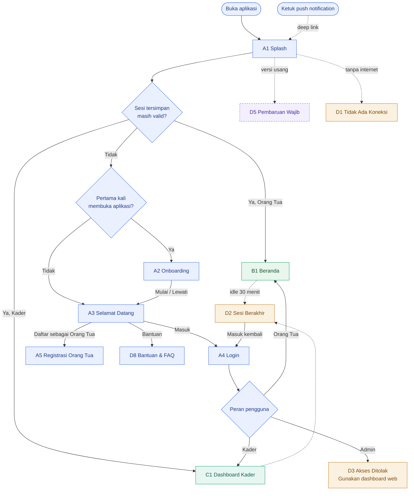

### 3.2 Autentikasi, Registrasi & Pemulihan Akun

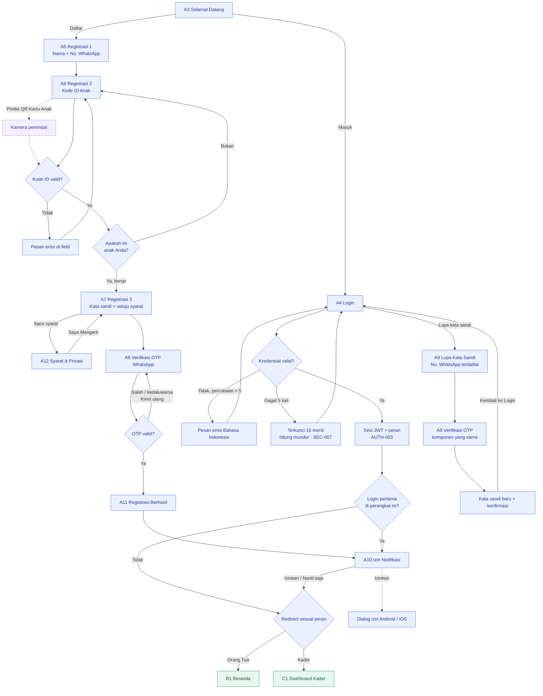

> **Catatan prototype:** login dibuat dengan dua tombol demo, **Masuk sebagai Orang Tua** dan **Masuk sebagai Kader**, agar setiap peran bisa dicoba tanpa backend. OTP, dialog izin sistem, dan kamera hanya berupa tampilan.

---

### 3.3 Struktur Navigasi Tab Bar

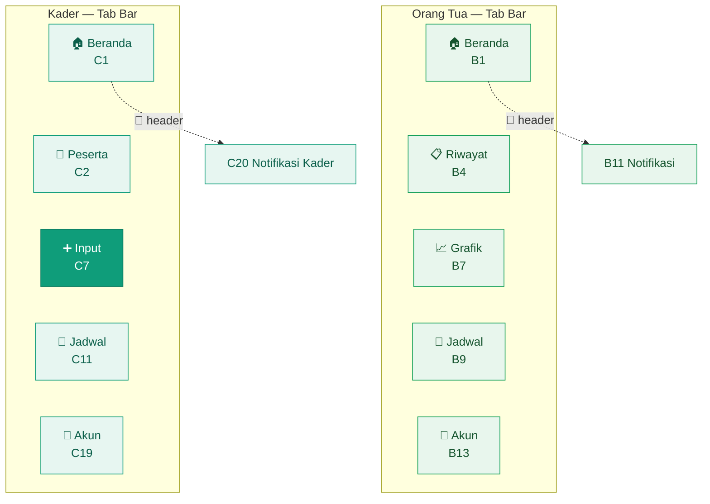

**Aturan navigasi:**
- Tab bar tampil di layar utama setiap tab. Layar turunan (detail, form) menyembunyikan tab bar dan memakai tombol **Kembali** di header.
- Mengetuk tab yang sedang aktif mengembalikan pengguna ke layar paling atas tab tersebut.
- Tombol ➕ kader selalu membuka **C7 Pilih Peserta**, dari tab mana pun.

---

### 3.4 Alur Orang Tua (Peserta)

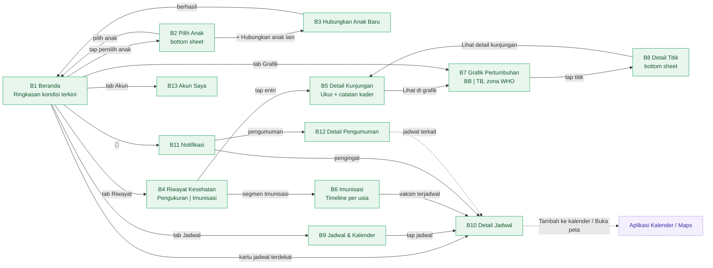

**Poin penting:**
- Semua layar orang tua hanya menampilkan data anak milik akun yang login (`SEC-004`, `SEC-005`).
- Anak aktif dipilih lewat **B2 bottom sheet** dari header Beranda. Pilihan ini berlaku di semua tab.
- Grafik B7 mendukung geser horizontal dan *pinch-to-zoom* (`GRAFIK-006`), serta mode layar penuh *landscape* 🟣.
- Daftar B4 dan B11 mendukung *pull-to-refresh*. Saat kosong, ditampilkan **D9 Empty State**.

---

### 3.5 Alur Kader (Input Data & Operasional)

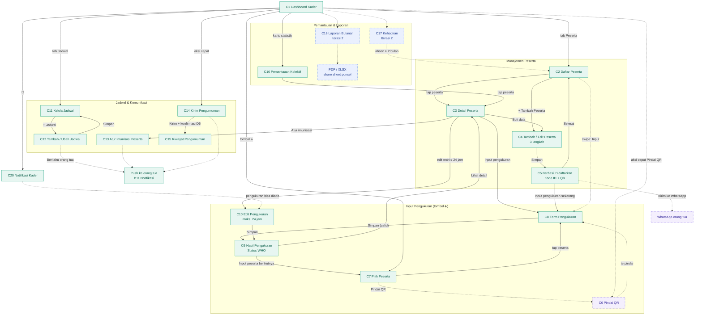

**Alur input pengukuran (C7 → C8 → C9) secara rinci:**

1. Kader mengetuk tombol **➕** dari tab mana pun, atau **Input pengukuran** dari Detail Peserta (C3).
2. Di **C7**, kader memilih peserta dari daftar **Belum ditimbang bulan ini**, mencari nama/Kode ID, atau 🟣 memindai QR Kartu Anak.
3. Di **C8**, kader mengisi BB dan TB dengan stepper/wheel picker, lingkar kepala (opsional), imunisasi hari ini (chip), dan catatan (maks. 200 karakter).
4. Validasi berjalan real-time. Nilai di luar rentang langsung ditandai merah di field terkait.
5. 🟣 Jika nilai berbeda jauh dari bulan lalu, muncul peringatan lunak "Sudah benar?".
6. **Simpan** menampilkan loading state (maks. 2 detik, `PERF-002`), lalu sistem menghitung status WHO dan menyimpan audit trail (nama kader + waktu).
7. **C9** menampilkan status, perubahan dari bulan lalu, dan saran tindak lanjut. Kader bisa langsung **Input peserta berikutnya** (kembali ke C7).
8. Data bisa diedit di **C10** selama 24 jam (`KADER-013`), dan langsung muncul di B1, B4, dan B7 milik orang tua.

---

### 3.6 Alur Akun & Pengaturan (Kedua Peran)

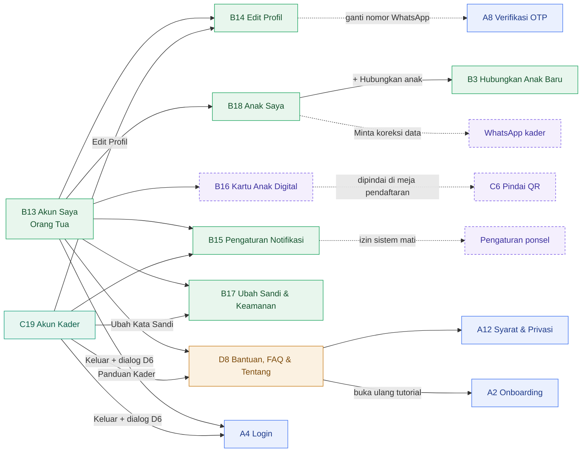

> B14, B15, B17, dan D8 dipakai bersama oleh kedua peran. Isinya menyesuaikan peran yang login.

---

### 3.7 Alur Layar Sistem & Komponen

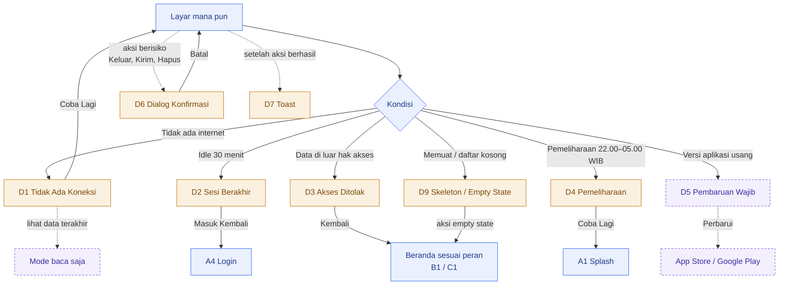

---

## 4. Sub-Alur Status Pertumbuhan (WHO)

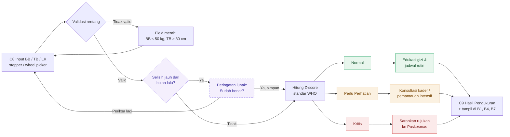

Status ini bersifat **indikatif** dan bukan pengganti konsultasi medis (SRS 2.4). Acuan: WHO Child Growth Standards dan Permenkes No. 2 Tahun 2020. Pengecekan selisih dari bulan lalu (ungu) adalah usulan mobile 🟣.

---

## 5. Sequence Diagram Alur Kritis

### 5.1 Membuka Aplikasi, Login & Redirect Peran

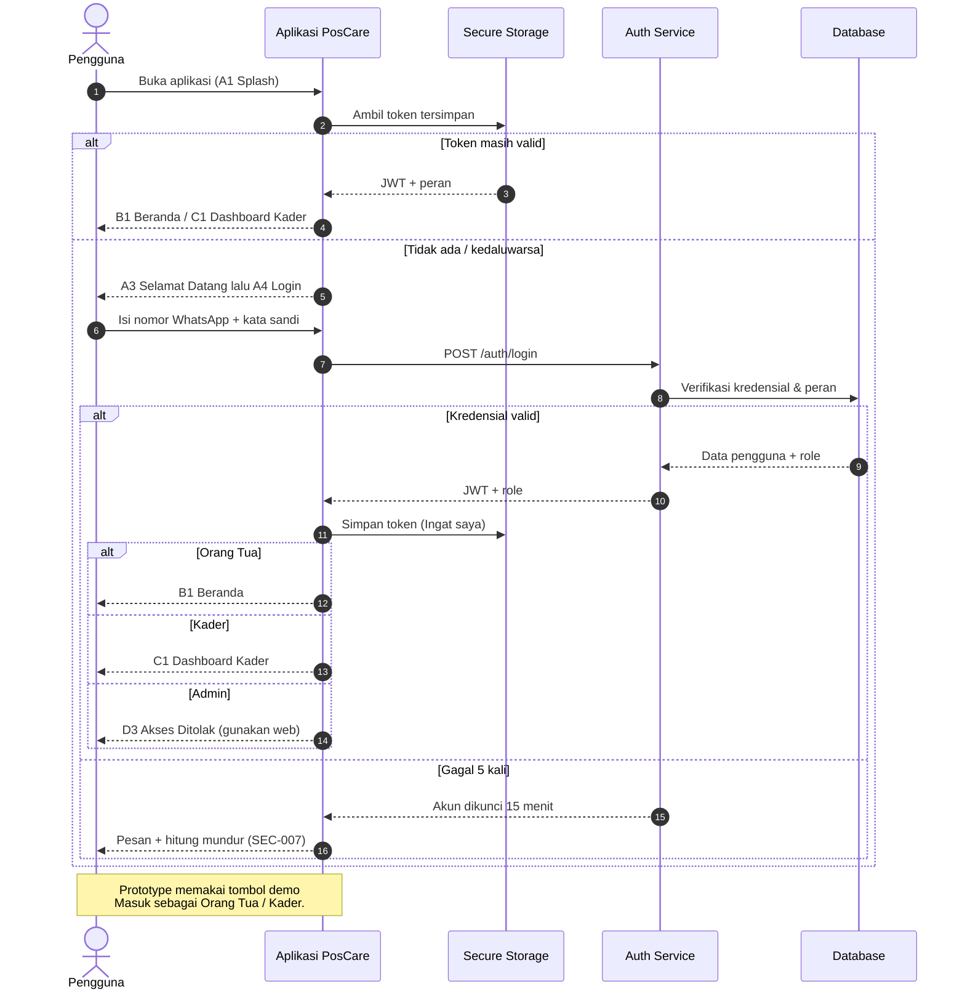

### 5.2 Input Pengukuran hingga Tampil ke Orang Tua

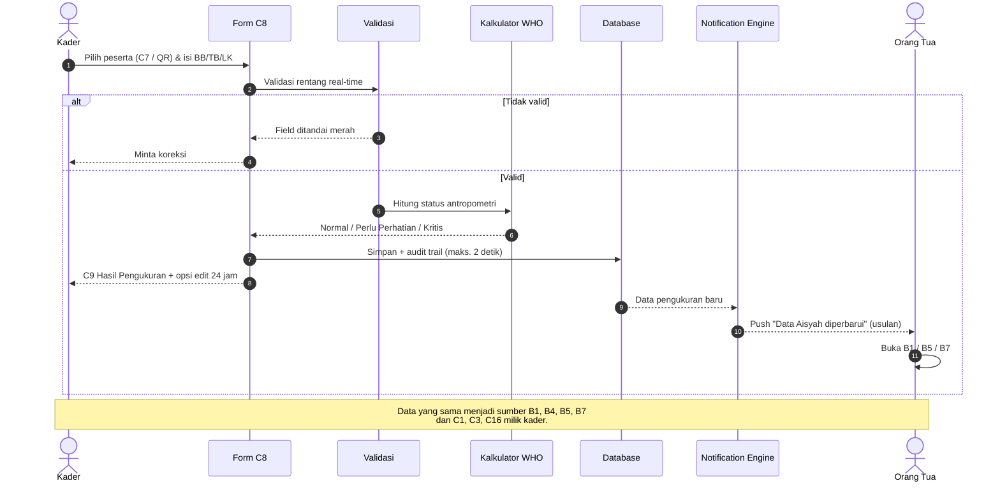

### 5.3 Pengingat Jadwal Otomatis (Push Native + WhatsApp)

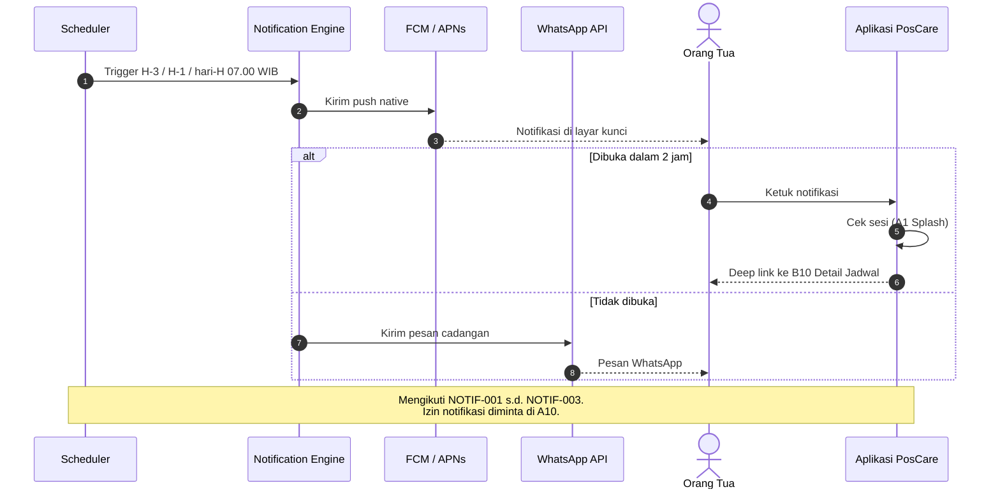

### 5.4 Pindai QR Kartu Anak di Meja Pendaftaran (Usulan 🟣)

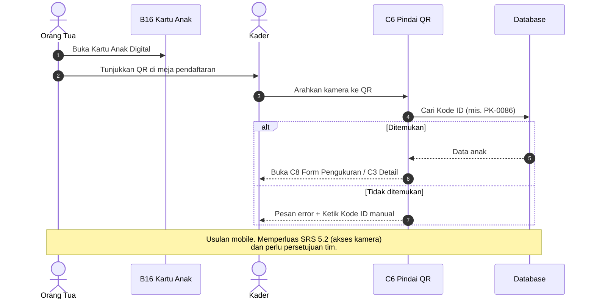

---

## 6. Matriks Hak Akses Aplikasi Mobile

| Fitur / Modul | Kader | Orang Tua | Admin |
|---|:---:|:---:|:---:|
| Registrasi & Login di aplikasi | ✅ (akun dibuat admin) | ✅ | ❌ (web) |
| Tambah/Edit Data Peserta | ✅ | ❌ | ❌ (web) |
| Input Hasil Pengukuran | ✅ | ❌ | ❌ (web) |
| Lihat Riwayat Anak | ✅ (semua) | ✅ (anak sendiri) | ❌ (web) |
| Lihat Grafik Pertumbuhan | ✅ (semua) | ✅ (anak sendiri) | ❌ (web) |
| Kelola Jadwal Kegiatan & Imunisasi | ✅ | ❌ | ❌ (web) |
| Terima Notifikasi Jadwal | ❌ (hanya notifikasi kader) | ✅ | ❌ |
| Kirim Pengumuman | ✅ | ❌ | ❌ (web) |
| Pemantauan Kehadiran 🔵 | ✅ | ❌ | ❌ (web) |
| Unduh Laporan Bulanan 🔵 | ✅ | ❌ | ❌ (web) |
| Kartu Anak Digital 🟣 | ✅ (memindai) | ✅ (menampilkan) | ❌ |
| Manajemen Akun Kader | ❌ | ❌ | ❌ (web) |

Sumber: SRS 8.2, disesuaikan untuk aplikasi mobile. Admin yang login di aplikasi diarahkan ke **D3 Akses Ditolak** dengan pesan untuk memakai dashboard web. Pelanggaran akses lain juga diarahkan ke **D3** (`SEC-004`, `SEC-005`).

---

## 7. Cakupan Modul & Layar

| Modul SRS | Layar Terkait | Status |
|---|---|---|
| AUTH | A1, A3–A9, A11, B14, B17, C19, D2 | 🟢 MVP |
| Dashboard Kader / Input Data (I-4) | C1–C5, C7–C13 | 🟢 MVP |
| Riwayat Kesehatan Anak (I-1) | B1–B6, B18, C3 | 🟢 MVP |
| Grafik Pertumbuhan & Status (I-3) | B1, B7, B8, C3, C9, C16 | 🟢 MVP |
| Pengingat Jadwal Otomatis (I-2) | A10, B9–B12, B15, C13–C15, C20 | 🟢 MVP + 🔵 (status kirim C15) |
| Pemantauan Kehadiran (I-6) | C17 | 🔵 Iterasi 2 |
| Rekap & Laporan Bulanan (I-5) | C18 | 🔵 Iterasi 2 |
| Keamanan & Privasi | A12, B17, D3 | 🟢 MVP |
| Utilitas sistem & komponen | D1–D9 | 🟢 MVP + 🟣 (D5) |
| Usulan mobile | B16, C6, D5, sebagian B10, B17, C5, C8, D1 | 🟣 Perlu persetujuan |

---

## 8. Catatan Implementasi Prototype Mobile

1. **Dibuat di Figma, tanpa backend.** Satu frame per layar (390 × 844 pt, iPhone 14/15) mengikuti `PosCare_Style_Guide.md`: warna utama `#0F9D7A`, aksen `#FF6B5A`, font Inter, kartu radius 16, teks isi min. 15 pt.
2. **Navigasi prototype.** Tab bar dibuat sebagai komponen dengan variant per tab aktif. Layar turunan memakai aksi **Back**. Tombol ➕ kader dihubungkan ke C7 dari semua tab utama.
3. **Overlay.** B2 Pilih Anak, B8 Detail Titik Grafik, D6 Dialog Konfirmasi, dan D7 Toast dibuka dengan *Open overlay* (posisi bawah untuk bottom sheet, tengah untuk dialog).
4. **Login demo.** A4 memiliki tombol **Masuk sebagai Orang Tua** dan **Masuk sebagai Kader** agar setiap alur peran bisa dicoba langsung.
5. **Interaksi tiruan.** OTP, dialog izin sistem, kamera/QR, push notification, deep link, *pull-to-refresh*, dan unduh PDF/XLSX hanya berupa tampilan. Bila perlu, push notification dibuat sebagai frame layar kunci yang mengarah ke B10.
6. **Data contoh konsisten.** Gunakan data yang sama di semua layar: Aisyah Farida (24 bulan, 11,2 kg, 85 cm, Normal), Raka Aditya (9 bulan, Perlu Perhatian), Bunda Dewi Lestari, Bu Sri Rahayu, Kode ID PK-0086, Posyandu Sabtu 14 Nov 2026 08.00 WIB.
7. **Label fase di frame.** Frame 🔵 Iterasi 2 dan 🟣 Usulan Mobile diberi label di pojok frame agar penguji tahu layar mana yang belum masuk MVP.
8. **Relasi dengan prototype web.** Kode layar mobile (A1–D9) **berbeda** dari kode halaman web (A1–E4). Pemetaannya:

| Fitur | Web | Mobile |
|---|---|---|
| Landing / pintu masuk | A1 Landing | A1 Splash, A3 Selamat Datang |
| Login / Registrasi / Lupa sandi | A2 / A3 / A4 | A4 / A5–A8, A11 / A9 |
| Onboarding / FAQ | A5 / A6 | A2 / D8 |
| Dashboard / Beranda peserta | B1 | B1 (+ B2, B3) |
| Riwayat / Detail kunjungan / Imunisasi | B2 / B3 / B4 | B4 / B5 / B6 |
| Grafik | B5 | B7 (+ B8) |
| Jadwal / Notifikasi / Pengaturan | B6 / B7 / B8 | B9–B10 / B11–B12 / B13–B18 |
| Dashboard kader / Daftar / Form / Detail | C1 / C2 / C3 / C4 | C1 / C2 / C4–C5 / C3 |
| Input pengukuran | C5 | C7–C10 |
| Jadwal / Imunisasi / Pengumuman | C6 / C7 / C8 | C11–C12 / C13 / C14–C15 |
| Kehadiran / Laporan | C9 / C10 | C17 / C18 |
| Admin | D1–D5 | — (tetap di web) |
| 404 / 403 / Sesi / Maintenance | E1 / E2 / E3 / E4 | — / D3 / D2 / D4 |

---

*Disusun berdasarkan SRS SiPosya v1.0, mobile-page.md (59 layar), dan PROTOTYPE-FLOW.md versi web — PosCare, 2026.*